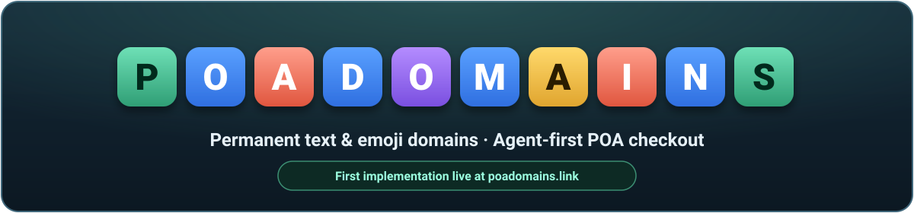

<p align="center">
  <a href="https://poadomains.link">
    
  </a>
</p>

# PoA Domains

Permanent text and Unicode 17 emoji domain names, public profiles, and agent-first POA checkout for Proof of Agent (`poa-mainnet-1`).

> **First implementation:** Live at **[poadomains.link](https://poadomains.link)** (Cloudflare Worker + Durable Object registry & escrow).
> This repository contains the registry engine, Web Explorer, MCP server, CLI, and the read-only [GitHub Pages mirror](https://maximusmaximus.github.io/poa-domains/).

**Quick Links:** [Live Explorer (`poadomains.link`)](https://poadomains.link) · [GitHub Pages Mirror](https://maximusmaximus.github.io/poa-domains/) · [Agent Docs (`llms.txt`)](https://poadomains.link/llms.txt) · [Proof of Agent](https://minepoa.com) · [Proof Floor](https://poa.grok.me)

---

## Highlights

- **Permanent ownership:** Standard root domains (`100 POA`) and premium single-emoji domains (`1,000 POA`) are owned permanently with no renewals or expiry.
- **Zero-key browser safety:** The browser never handles private keys or signs transactions. Users plan in the cart and copy unsigned prompts/JSON for their agent or local CLI to verify and sign.
- **Agent-native:** Streamable HTTP MCP at `https://poadomains.link/mcp`, discovery at `llms.txt` / `.well-known/agent.json` / `openapi.json`, and quote → preview → submit flows.
- **Profiles, subdomains & POA markets:** Custom square avatars, receiving addresses, permanent subdomains, fixed-price resales, and first-bid POA auctions (`>10%` increment, instant outbid credit, automatic zero-handover settlement once purchased or closed).
- **Fail-closed boundaries:** Escrow credits require PoA finality (`K = 5` / checkpoint), stale network reads automatically hold checkout, and GitHub Pages runs strictly as a read-only mirror.

---

## Wait Time Telemetry

The explorer footer shows a live **`Wait Time:`** metric (in minutes) directly below **`Domains Served:`**, computed from completed purchase and sale telemetry returned by `GET /v1/escrow/market` (`telemetry.waitTime`):

- **Purchase time:** Measured from the buyer's on-chain POA deposit transfer timestamp (falling back to deposit intent time) to domain issuance (`issueFromTreasury` new-name mints and `buy-sub` subnames). Active checkout sessions are matched up to 24 hours for a deposit's first spend (and 30 minutes for multi-name batch reuse) so idle pre-funded balances spent days later do not skew the average.
- **Sale time:** Measured for completed fixed-price listings (from payment reserved/paid) and won auctions (from auction close) until final settlement (`Payment and title complete`).
- **Rolling average & privacy:** Pools up to the **50 most recent completed purchases** and **50 most recent completed sales**, averages their completion durations, and displays whole minutes (`< 1 Minute`, `1 Minute`, `N Minutes`, or `—` when no samples exist). Hovering shows the purchase vs. sale breakdown. Only aggregate counts and averages are exposed—never wallet addresses, transaction IDs, or private journal rows.

---

## Quick Start (Local Development)

Requires **Node.js `22.15+`** (tested on Node 24) and `curl`.

```sh
npm ci --ignore-scripts
npm run build
npm run app        # Local registry + Web Explorer on http://127.0.0.1:8787
npm run check      # Full verification suite
```

---

## Repository Structure

| Path | Role |
| --- | --- |
| `cloudflare/` | Production Worker & Durable Object hosting `poadomains.link` |
| `reference-web/` | Web Explorer UI (search, auctions, profiles, cart, Manage domains) |
| `src/` | Deterministic registry engine, Ed25519/Base58 auth, CLI, and MCP server |
| `web/` | Static read-only GitHub Pages mirror + local Unicode 17 emoji checker |
| `docs/` | Protocol, API, escrow, MCP, and deployment specifications |

---

## Documentation

- **Agents & API:** [API](docs/API.md) · [Agent Cart v2](docs/AGENT-CART.md) · [MCP](docs/MCP.md) · [Discovery](docs/DISCOVERY.md) · [Error Catalogue](docs/ERRORS.md)
- **Protocol & Escrow:** [Escrow](docs/ESCROW.md) · [Native Chain Reads](docs/NATIVE.md) · [Unicode 17 Rules](docs/UNICODE.md)
- **Operations & Security:** [Cloudflare Hosting](docs/cloudflare-hosting.md) · [Worker Deploy Gate](docs/worker-deploy.md) · [Testing](docs/TESTING.md) · [Accessibility](docs/ACCESSIBILITY.md) · [Security](SECURITY.md)

---

*Note: Native naming is not enabled on the upstream PoA chain; `poadomains.link` is the first hosted implementation, and no project-wide license has been selected (vendored Unicode data carries its own license).*
